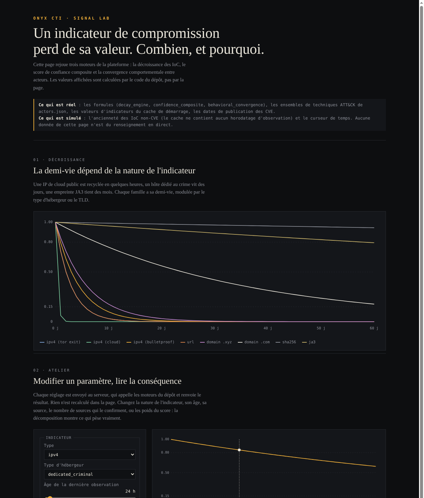
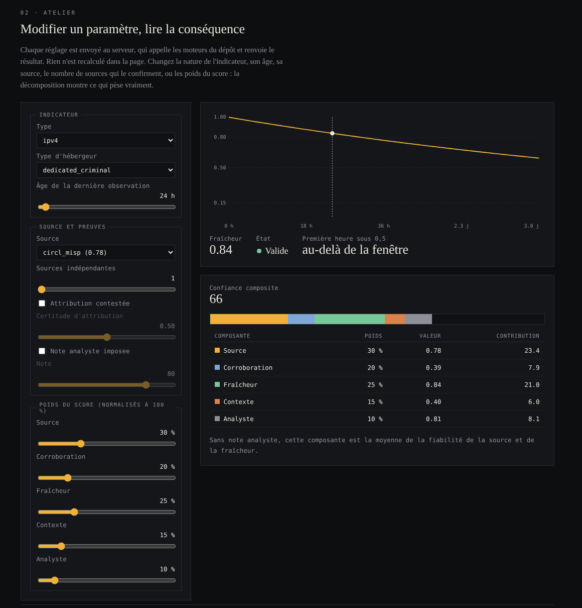
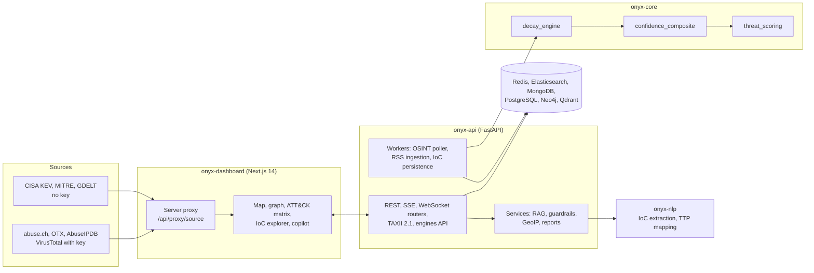

# ONYX CTI

**A Cyber Threat Intelligence platform that tells you how much an indicator is still worth, and why.**

Most threat feeds ship indicators of compromise (IoCs) with no expiry date: an IP address reported three months ago weighs as much as one seen this morning. ONYX aggregates OSINT sources, links them to threat actors and to the MITRE ATT&CK framework, then gives every indicator a confidence score that decays over time, strengthens with corroboration and breaks down into readable components.



## See the idea in thirty seconds

The `demo/` folder contains **Signal Lab**, a four-part experience built on the repository's real engines.

```bash
python3 demo/lab_server.py          # or: make lab   ->   http://127.0.0.1:8765
```

The server uses only the Python standard library, listens on 127.0.0.1 only, and calls the same facade (`onyx-api/onyx_api/services/analysis.py`) as the REST API. Without the server, `demo/ONYX_Signal_Lab.html` opens with a double-click and keeps the precomputed sections.

| Section | What it shows | Works without server |
|---|---|---|
| 01 Decay | Half-life per indicator family (IP, URL, domain, hash, JA3) | yes |
| 02 Workshop | Type, hosting provider or TLD, age, source, number of sources, contestation, analyst note, weights: every setting is recomputed by the engines and the score breakdown is readable | no |
| 03 Board | Re-ranking of the 16 IoCs in the startup cache as time passes, ONYX confidence compared with the confidence claimed by the source | yes |
| 04 Convergence | Jaccard similarity between 12 MITRE groups, at technique or parent-technique level | yes |



What is simulated, and flagged as such in the page: the age of the non-CVE IoCs on the board (the cache holds no observation timestamp). The publication dates of the two CVEs are real. Nothing here is live intelligence.

One result the tool makes visible: on the techniques documented in `actors.json`, no pair of groups reaches the engine's convergence threshold of 0.65, neither at full technique level (maximum 0.31) nor at parent-technique level (maximum 0.42). That threshold is a parameter to recalibrate, not a truth.

## Dashboard: Intelligence page

The `/intelligence` route of the Next.js dashboard reproduces the workshop and the convergence matrix, fed live by `/api/v1/engines/*` (loading, error and retry states, cancellable requests, no added dependency). Styles are scoped under `.ix`: the rest of the dashboard is untouched.

```bash
cd onyx-dashboard && npm install && npm run dev      # http://localhost:3000/intelligence
cd onyx-api && uvicorn onyx_api.main:app --port 8000
```

This page was checked with strict type checking against minimal React declarations; `next build` could not be run in the development environment (no npm registry access). See "Known limitations".

### Engines API

| Method | Route | Purpose |
|---|---|---|
| GET | `/api/v1/engines/meta` | Accepted parameters (types, hosts, TLDs, sources, default weights) |
| POST | `/api/v1/engines/assess` | Freshness, composite confidence and each component's contribution |
| POST | `/api/v1/engines/curve` | Decay over time for an indicator profile |
| GET | `/api/v1/engines/convergence/matrix?level=technique\|parent` | Jaccard matrix over the MITRE export |
| GET | `/api/v1/engines/convergence/pair?a=&b=&level=` | Comparison of two actors, shared techniques |

These routes are read-only, store nothing and bound their inputs (window size, number of points, number of techniques); invalid input returns 422.

## What sets ONYX apart

**Decay per indicator nature.** A public-cloud IP is recycled within hours (6 h half-life), a crime-dedicated host lasts four days, a JA3 fingerprint six months. A domain's half-life depends on its TLD and the tier of its registrar. A file hash never drops below 0.30: it stays useful for forensics. At the half-life, the score is exactly 0.5 by construction.

**A decomposable confidence score.** Five weighted components: source reliability (Admiralty-style table), corroboration, freshness, contextual relevance, analyst override. A contested attribution applies a multiplicative penalty. Every component is exposed so the analyst can see where the number comes from.

**Behavioural comparison between actors.** Jaccard similarity on ATT&CK technique sets, with a convergence threshold and an interpretation text.

**A full platform around these engines**: Next.js dashboard (deck.gl geopolitical map, threat graph, ATT&CK matrix, IoC explorer), FastAPI API with JWT authentication, TAXII 2.1 server, STIX 2.1 export, NLP-based IoC extraction and TTP mapping, RAG assistant.

## Architecture



API keys never leave the server: the browser calls `/api/proxy/[source]`, which adds the secrets on the Next.js side.

### Life of an indicator

```mermaid
flowchart TD
    A[IoC observation<br/>source + date] --> B[calculate_decay<br/>type, host, TLD, learned half-life]
    B --> C[classify_decay_state<br/>valid, degraded, stale, obsolete]
    A --> D[get_source_reliability]
    A --> E[corroboration_score<br/>1 - exp&#40;-0.5 n&#41;]
    B --> F[calculate_composite_confidence]
    D --> F
    E --> F
    F --> G[Score 0 to 1 + breakdown]
```



### Repository layout

| Folder | Role |
|---|---|
| `onyx-dashboard/` | Next.js 14 interface, OSINT connectors, client-side STIX export |
| `onyx-api/` | FastAPI API: routers, services (RAG, guardrails, GeoIP, reports), workers |
| `onyx-core/` | STIX models, decay, confidence and scoring engines, storage clients |
| `onyx-nlp/` | IoC and TTP extractors, processing pipeline |
| `onyx-crawlers/` | Clearweb and darkweb (Tor) crawlers |
| `infra/` | Elasticsearch, MongoDB, Tor configuration |
| `demo/` | Signal Lab (see above) |
| `scripts/` | `gen_env.py` (secrets), demo data injection, feed checks |

## Security

Changes made in this branch:

- No hardcoded account or default password remains. Bootstrap accounts come only from the environment variables `ONYX_BOOTSTRAP_ADMIN_PASSWORD[_HASH]` and `ONYX_BOOTSTRAP_ANALYST_PASSWORD[_HASH]`. In development a random admin password is generated and logged once; in production there is none unless configured.
- The login bypass that applied when `STANDALONE_MODE=true` is removed: the same bcrypt verification runs whether or not the user exists, and failure always returns 401.
- CORS is no longer a wildcard: origins come from configuration, with explicit methods and headers.
- `/_internal/seed` requires the admin role.
- Postgres, Neo4j, Redis and Celery credentials are built from the environment; `docker-compose.yml` refuses to start if they are missing (`python3 scripts/gen_env.py` generates them).
- `ONYX_DEBUG` defaults to false. In production, a weak or missing JWT secret aborts startup.

The decision logic lives in `onyx-core/onyx_core/security_policy.py` (standard library only) and is covered by tests. Still missing: login rate limiting, a persistent user store, persistent token revocation, authentication on the `/engines` routes if they are exposed publicly.

## Getting started

Requirements: Python 3.11 or later, Node.js 18.17 or later, Docker with Compose.

```bash
git clone https://github.com/Amalkaraoud/CTI-Platform-.git
cd CTI-Platform-
python3 scripts/gen_env.py  # creates .env with random secrets; add API keys and the admin account there

docker compose up -d        # infrastructure and backend (STANDALONE_MODE enabled in the compose file)

cd onyx-dashboard
npm install
npm run dev                 # http://localhost:3000
```

To run the API without Docker:

```bash
pip install -r requirements.txt
pip install -e onyx-core -e onyx-api
cd onyx-api && uvicorn onyx_api.main:app --reload --port 8000
```

`STANDALONE_MODE=true` lets the platform run without the full infrastructure. On Windows, `start_ONYX_demo.bat` starts the API, the dashboard and an NLP test.

### OSINT sources

| No key | Free key |
|---|---|
| CISA KEV, GDELT, MITRE ATT&CK, OpenPhish, Tor exit nodes, NVD, CIRCL, ReliefWeb | abuse.ch (URLhaus, ThreatFox, MalwareBazaar), AlienVault OTX, AbuseIPDB, VirusTotal |

Sign-ups: [abuse.ch](https://auth.abuse.ch/), [OTX](https://otx.alienvault.com/), [AbuseIPDB](https://www.abuseipdb.com/register), [VirusTotal](https://www.virustotal.com/gui/join-us), [NVD](https://nvd.nist.gov/developers/request-an-api-key).

## Tests

```bash
make test
```

Five files need only `pytest` (they load the engines by path, with no FastAPI or database): `test_engines_smoke.py`, `test_security_policy.py`, `test_convergence.py`, `test_analysis.py`, plus `test_lab_server.py`, which starts the lab server and queries it over HTTP. The existing `test_decay_engine.py` and `test_confidence_composite.py` also depend on `hypothesis`; `test_ioc_persister_decay.py` is an integration test.

## Validation: what was actually run

| Item | Status |
|---|---|
| 66 tests (engines, security policy, analysis facade, lab server over real HTTP) | run, passed (also re-run on the maintainer's Windows machine: 66 passed) |
| Signal Lab served by `lab_server.py`, queried with curl, rendered and captured with Chrome | run |
| Python compilation of all modified files | run |
| Strict type check of the `/intelligence` page against minimal React declarations | run, no error |
| `next build`, `npm run dev`, real rendering of `/intelligence` | not run |
| Full FastAPI API (login, CORS, production startup) | not run; the wiring of `jwt.py`, `auth.py`, `main.py` was only compiled |
| Docker stack (compose, Neo4j, PostgreSQL, Elasticsearch) | not run |
| `test_decay_engine.py`, `test_confidence_composite.py` (hypothesis), `test_ioc_persister_decay.py` | not run |

To validate the rest on a machine with network access: `pip install -r requirements.txt pytest hypothesis`, `make test`, `cd onyx-dashboard && npm install && npm run build`, then `docker compose up`.

## Known limitations

- The static technique sets in `behavioral_convergence.py` (12 actors) are smaller than those in `actors.json`; the 0.65 threshold needs recalibrating on the full data.
- PostgreSQL and Neo4j are declared in the compose file and have clients in `onyx-core`, but their end-to-end integration has not been verified.
- The rest of the dashboard (map, graph, copilot) was not reworked; only the `/intelligence` page is new.
- WCAG contrast and strict STIX 2.1 compliance were not validated with a tool.

## Next steps

- Feed per-actor half-lives from real observations (the `decay_learning_worker.py` worker lays the groundwork).
- Calibrate the convergence threshold and compare at parent-technique level.
- Extend continuous integration (`.github/workflows/ci.yml` runs the Python tests and the demo build; the dashboard build is still to add).
- Link the `/intelligence` page into the dashboard's main navigation.

## License and author

MIT, see [LICENSE](LICENSE). Project by Amal Karaoud ([@Amalkaraoud](https://github.com/Amalkaraoud)).
