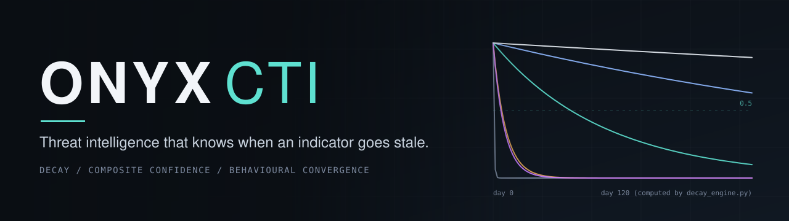
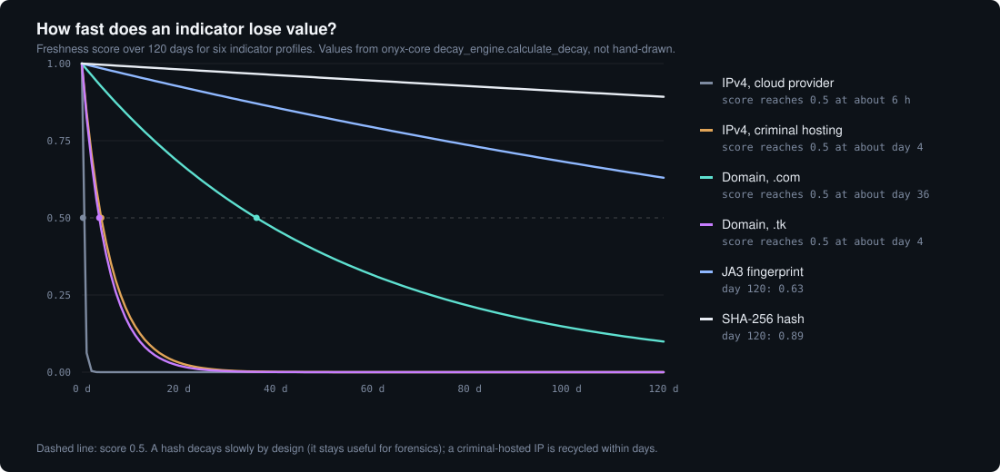
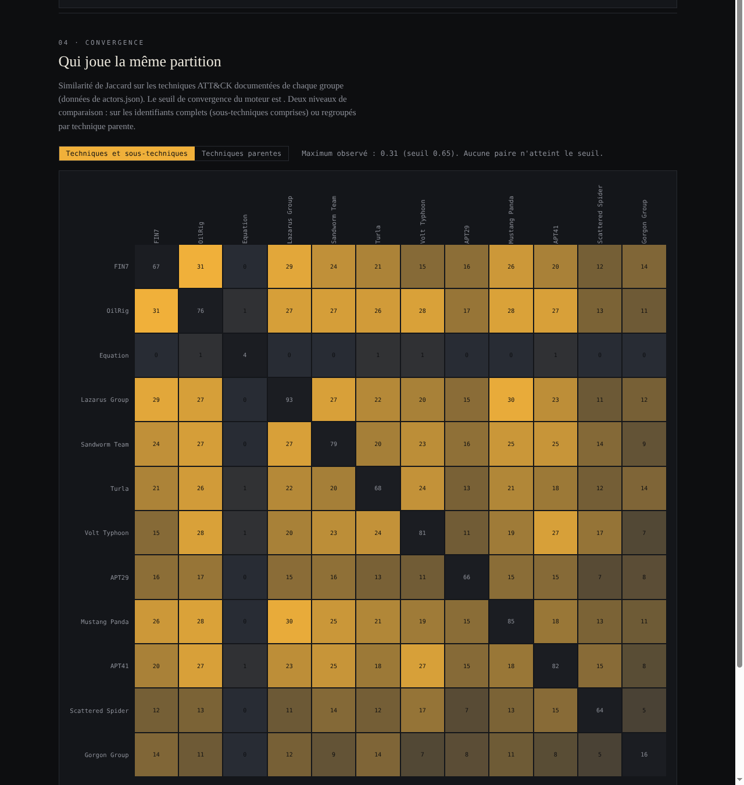
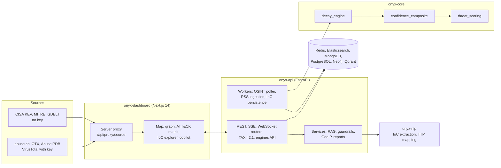

<div align="center">



<br>

**Most threat feeds tell you an indicator is malicious. ONYX also tells you how much it is still worth.**

[Signal Lab](#signal-lab) &nbsp;&middot;&nbsp; [Engines](#the-three-engines) &nbsp;&middot;&nbsp; [Architecture](#architecture) &nbsp;&middot;&nbsp; [Security](#security) &nbsp;&middot;&nbsp; [Quick start](#getting-started) &nbsp;&middot;&nbsp; [Validation](#validation-what-was-actually-run)

</div>

| Scoring engines | IoC types handled | Confidence components | Verified tests | Actors compared |
|:---:|:---:|:---:|:---:|:---:|
| **3** | **16** | **5** | **66 passing** | **12** (MITRE ATT&CK) |

An IP address reported three months ago weighs as much as one seen this morning in most feeds. ONYX aggregates OSINT sources, links them to threat actors and MITRE ATT&CK, then gives every indicator a score that **decays with time**, **strengthens with corroboration** and **breaks down into components an analyst can read**.



*Curves computed by the repository's own decay engine (`demo/build_readme_assets.py`), not drawn by hand.*

## Signal Lab

A four-part interactive experience built on the real engines, shipped in [`demo/`](demo). No dependency beyond Python.

```bash
python3 demo/lab_server.py      # http://127.0.0.1:8765   (or: make lab)
```


| Section | What it shows | Without the server |
|---|---|---|
| 01 Decay | Half-life per indicator family (IP, URL, domain, hash, JA3) | yes |
| 02 Workshop | Every setting (type, host or TLD, age, source, corroboration, contestation, analyst note, weights) recomputed by the engines, with a readable score breakdown | no |
| 03 Board | The 16 IoCs of the startup cache re-ranked as time passes, ONYX confidence against the confidence claimed by the source | yes |
| 04 Convergence | Jaccard similarity between 12 MITRE groups, at technique or parent-technique level | yes |

`demo/ONYX_Signal_Lab.html` opens with a double-click and keeps the precomputed sections. The server uses the standard library only, listens on 127.0.0.1 and calls the same facade as the REST API.


What is simulated, and flagged as such in the page: the age of the non-CVE IoCs on the board (the cache holds no observation timestamp). Nothing here is live intelligence.



A result the tool makes visible: on the techniques documented in `actors.json`, **no pair of groups reaches the engine's 0.65 convergence threshold** (maximum 0.31 at technique level, 0.42 at parent level). The threshold is a parameter to recalibrate, not a truth.

## The three engines

| Engine | Question it answers | How |
|---|---|---|
| `decay_engine` | How fresh is this indicator? | Exponential decay with a half-life per nature of indicator: a public-cloud IP is recycled within hours (6 h), a criminal host lasts four days, a JA3 fingerprint six months. A domain's half-life depends on its TLD and registrar tier. A file hash never drops below 0.30. At the half-life the score is exactly 0.5 by construction. |
| `confidence_composite` | How much should I trust it? | Five weighted components: source reliability (Admiralty-style table), corroboration, freshness, contextual relevance, analyst override. A contested attribution applies a multiplicative penalty. Every component is exposed. |
| `behavioral_convergence` | Do two actors behave alike? | Jaccard similarity on ATT&CK technique sets, with a convergence threshold and an interpretation text. |

Around them: a Next.js dashboard (deck.gl geopolitical map, Cytoscape threat graph, ATT&CK matrix, IoC explorer), a FastAPI backend with JWT authentication, a TAXII 2.1 server, STIX 2.1 export, NLP-based IoC extraction and TTP mapping, and a RAG assistant. OSINT feeds include CISA KEV, MITRE ATT&CK, GDELT, abuse.ch, AlienVault OTX, AbuseIPDB and VirusTotal.

### Dashboard: `/intelligence`

The Next.js route `/intelligence` reproduces the workshop and the convergence matrix, fed live by `/api/v1/engines/*` (loading, error and retry states, cancellable requests, no added dependency, styles scoped under `.ix`).

### Engines API

| Method | Route | Purpose |
|---|---|---|
| GET | `/api/v1/engines/meta` | Accepted parameters (types, hosts, TLDs, sources, default weights) |
| POST | `/api/v1/engines/assess` | Freshness, composite confidence and each component's contribution |
| POST | `/api/v1/engines/curve` | Decay over time for an indicator profile |
| GET | `/api/v1/engines/convergence/matrix?level=technique\|parent` | Jaccard matrix over the MITRE export |
| GET | `/api/v1/engines/convergence/pair?a=&b=&level=` | Comparison of two actors, shared techniques |

These routes are read-only, store nothing and bound their inputs (window size, number of points, number of techniques); invalid input returns 422.

## Architecture



API keys never leave the server: the browser calls `/api/proxy/[source]`, which adds the secrets on the Next.js side.

### Life of an indicator

```mermaid
flowchart TD
    A[IoC observation<br/>source + date] --> B[calculate_decay<br/>type, host, TLD, learned half-life]
    B --> C[classify_decay_state<br/>valid, degraded, stale, obsolete]
    A --> D[get_source_reliability]
    A --> E[corroboration_score<br/>1 - exp&#40;-0.5 n&#41;]
    B --> F[calculate_composite_confidence]
    D --> F
    E --> F
    F --> G[Score 0 to 1 + breakdown]
```



### Repository layout

| Folder | Role |
|---|---|
| `onyx-dashboard/` | Next.js 14 interface, OSINT connectors, client-side STIX export |
| `onyx-api/` | FastAPI API: routers, services (RAG, guardrails, GeoIP, reports), workers |
| `onyx-core/` | STIX models, decay, confidence and scoring engines, storage clients |
| `onyx-nlp/` | IoC and TTP extractors, processing pipeline |
| `onyx-crawlers/` | Clearweb monitors and darkweb crawlers (Scrapy spider through Tor, httpx/Playwright spiders) |
| `onyx-analyzers/` | SIEM query generation and YARA / Sigma rule generation |
| `onyx-connectors/` | STIX 2.1 / TAXII, MISP and Splunk HEC export, driven by environment-configured destinations |
| `infra/` | Elasticsearch, MongoDB, Tor, TLS 1.3 edge (nginx) configuration |
| `demo/` | Signal Lab (see above) |
| `scripts/` | `gen_env.py` (secrets), demo data injection, feed checks |

## Security

Changes made in this branch:

- No hardcoded account or default password remains. Bootstrap accounts come only from the environment variables `ONYX_BOOTSTRAP_ADMIN_PASSWORD[_HASH]` and `ONYX_BOOTSTRAP_ANALYST_PASSWORD[_HASH]`. In development a random admin password is generated and logged once; in production there is none unless configured.
- The login bypass that applied when `STANDALONE_MODE=true` is removed: the same bcrypt verification runs whether or not the user exists, and failure always returns 401.
- CORS is no longer a wildcard: origins come from configuration, with explicit methods and headers.
- `/_internal/seed` requires the admin role.
- Postgres, Neo4j, Redis and Celery credentials are built from the environment; `docker-compose.yml` refuses to start if they are missing (`python3 scripts/gen_env.py` generates them).
- `ONYX_DEBUG` defaults to false. In production, a weak or missing JWT secret aborts startup.

- Rate limiting (`onyx_core/ratelimit.py`, applied by `RateLimitAuditMiddleware`): sliding window per client address, with a much stricter budget on `/auth` paths. Tune with `ONYX_RATE_LIMIT` and `ONYX_AUTH_RATE_LIMIT` (for example `1200/60`).
- Audit trail (`onyx_core/audit.py`): one JSON line per sensitive event (logins, mutating requests, `/internal`, TAXII), secrets scrubbed. Lines go to the `onyx.audit` logger, optionally to `ONYX_AUDIT_LOG`, and to the `onyx_audit_log` PostgreSQL table when `POSTGRES_URL` is set.
- Accounts and roles are stored in PostgreSQL (`onyx_users`) when `POSTGRES_URL` is set; bootstrap accounts are inserted once and never overwritten. Without it, accounts stay in memory (standalone mode).
- Export destinations and rule generation inputs are validated; export destinations come from environment variables only, never from a request.
- TLS 1.3: `docker compose --profile tls up` starts an nginx edge (`infra/nginx`) that refuses anything below TLS 1.3. Certificates are mounted, not committed.

The decision logic lives in `onyx-core/onyx_core/security_policy.py` (standard library only) and is covered by tests. Still missing: persistent token revocation, authentication on the `/engines` routes if they are exposed publicly.

## Getting started

Requirements: Python 3.12 or later, Node.js 18.17 or later, Docker with Compose.

```bash
git clone https://github.com/Amalkaraoud/CTI-Platform-.git
cd CTI-Platform-
python3 scripts/gen_env.py  # creates .env with random secrets; add API keys and the admin account there

docker compose up -d        # redis, postgres, neo4j, mongodb, elasticsearch, qdrant, tor-proxy, backend,
                            # celery worker + beat, ioc-persister, dashboard (STANDALONE_MODE enabled by default)

cd onyx-dashboard
npm install
npm run dev                 # http://localhost:3000
```

To run the API without Docker:

```bash
pip install -r requirements.txt
pip install -e onyx-core -e onyx-api
cd onyx-api && uvicorn onyx_api.main:app --reload --port 8000
```

`STANDALONE_MODE=true` lets the platform run without the full infrastructure. On Windows, `start_ONYX_demo.bat` starts the API, the dashboard and an NLP test.

### OSINT sources

| No key | Free key |
|---|---|
| CISA KEV, GDELT, MITRE ATT&CK, OpenPhish, Tor exit nodes, NVD, CIRCL, ReliefWeb | abuse.ch (URLhaus, ThreatFox, MalwareBazaar), AlienVault OTX, AbuseIPDB, VirusTotal |

Sign-ups: [abuse.ch](https://auth.abuse.ch/), [OTX](https://otx.alienvault.com/), [AbuseIPDB](https://www.abuseipdb.com/register), [VirusTotal](https://www.virustotal.com/gui/join-us), [NVD](https://nvd.nist.gov/developers/request-an-api-key).

## Tests

```bash
make test
```

The CI workflow runs the suites below (about 116 tests, no running services needed): engines, security policy, rate limiting and audit, Cypher builders, IOC-to-graph projection, user and audit store (on SQLite, same SQL as PostgreSQL), STIX custom properties, the API helpers, rule generation, export (against local stand-in HTTP servers) and crawler page extraction.

Five files need only `pytest` (they load the engines by path, with no FastAPI or database): `test_engines_smoke.py`, `test_security_policy.py`, `test_convergence.py`, `test_analysis.py`, plus `test_lab_server.py`, which starts the lab server and queries it over HTTP. The existing `test_decay_engine.py` and `test_confidence_composite.py` also depend on `hypothesis`; `test_ioc_persister_decay.py` is an integration test.

## Validation: what was actually run

| Item | Status |
|---|---|
| 66 tests (engines, security policy, analysis facade, lab server over real HTTP) | run, passed (also re-run on the maintainer's Windows machine: 66 passed) |
| 116 tests across all packages, including the new modules listed under Tests | run, passed (Python 3.13 sandbox) |
| Signal Lab served by `lab_server.py`, queried with curl, rendered and captured with Chrome | run |
| Python compilation of all modified files | run |
| Strict type check of the `/intelligence` page against minimal React declarations | run, no error |
| `next build`, `npm run dev`, real rendering of `/intelligence` | not run |
| Full FastAPI API (login, CORS, production startup) | not run; the wiring of `jwt.py`, `auth.py`, `main.py` was only compiled |
| Docker stack (compose, Neo4j, PostgreSQL, Elasticsearch) | not run |
| `test_decay_engine.py`, `test_confidence_composite.py` (hypothesis), `test_ioc_persister_decay.py` | not run |
| GraphQL schema (Strawberry), Celery worker and beat, Neo4j writes, PostgreSQL via psycopg2, Scrapy spider, nginx TLS edge | not run: written and checked at the unit level only |
| YARA rules compiled with `yara`; export against a real MISP, OpenCTI or Splunk | not run |

To validate the rest on a machine with network access: `pip install -r requirements.txt pytest hypothesis`, `make test`, `cd onyx-dashboard && npm install && npm run build`, then `docker compose up`.

## Known limitations

- The static technique sets in `behavioral_convergence.py` (12 actors) are smaller than those in `actors.json`; the 0.65 threshold needs recalibrating on the full data.
- PostgreSQL (accounts, audit) and Neo4j (relationship graph) are now wired in code, but no end-to-end run against the real databases has been made.
- Retrieval embeddings (RAG, Qdrant) use Gemini vectors, while SciBERT (768 dimensions) is used for extraction and TTP mapping only; no SciBERT weights are shipped. See `docs/ARCHITECTURE_CONFORMITY.md`.
- The dashboard does not validate API responses with Zod yet: run `npm install zod` first, because the Docker build uses `npm ci`.
- No Wazuh export connector exists; MISP, TAXII (OpenCTI, Elastic) and Splunk HEC do.
- The rest of the dashboard (map, graph, copilot) was not reworked; only the `/intelligence` page is new. This README shows no screenshot of the main dashboard because none has been captured from a running instance yet.
- WCAG contrast and strict STIX 2.1 compliance were not validated with a tool.

## Next steps

- Feed per-actor half-lives from real observations (the `decay_learning_worker.py` worker lays the groundwork).
- Calibrate the convergence threshold and compare at parent-technique level.
- Extend continuous integration with the dashboard build and an integration job that starts the compose stack.
- Link the `/intelligence` page into the dashboard's main navigation.

## License and author

MIT, see [LICENSE](LICENSE). Project by Amal Karaoud ([@Amalkaraoud](https://github.com/Amalkaraoud)).
